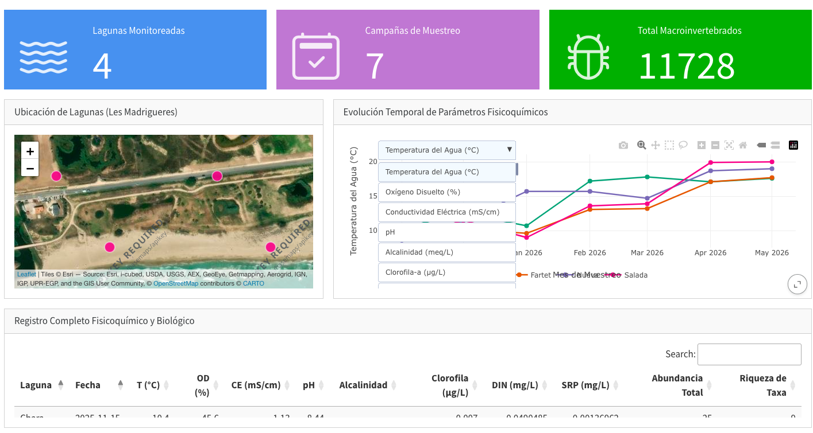
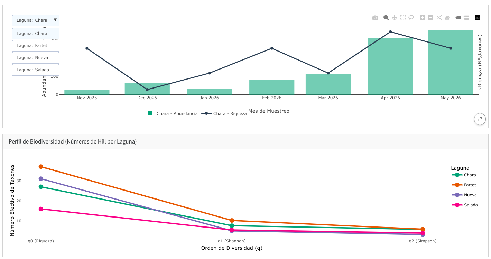

# 🌊 Monitoreo Estado Ecológico y Calidad de Agua en Lagunas Costeras

> **Dashboard analítico interactivo para la evaluación limnológica, calidad físico-química y dinámica de macroinvertebrados acuáticos en humedales costeros de Tarragona (España).**

[](https://milagrosbodega.github.io/monitoreo-ecologico-quarto/)
[](https://www.r-project.org/)
[](https://quarto.org/)
[](LICENSE)

🔗 **Acceso directo al dashboard:** [https://milagrosbodega.github.io/monitoreo-ecologico-quarto/](https://milagrosbodega.github.io/monitoreo-ecologico-quarto/)

---

## 📌 Vista Previa del Dashboard

| Monitoreo Físico-Químico y Mapeo Espacial | Análisis de Biodiversidad (números de Hill) |
| :---: | :---: |
|  |  |

---

## 🎯 Objetivo del proyecto

Este proyecto integra datos fisico-químicos y biológicos multianuales para monitorizar el estado de conservación y la evolución ecológica de un sistema lagunar ubicado en un área costera en Tarragona, Cataluña. Proporciona una herramienta interactiva abierta para la visualización de los datos obtenidos, una divulgación más clara y constantemente actualizable con futuros monitoreos.

---

## 🔬 Metodología y enfoque técnico

1. **Estandarización y Curaduría de Datos:** Limpieza y validación de series temporales fisicoquímicas (oxígeno, conductividad, pH, nutrientes) y ensambles taxonómicos crudos de macroinvertebrados mediante flujos reproducibles en R (`tidyverse`).
2. **Evaluación de Biodiversidad mediante Números de Hill:** Cálculo del perfil de diversidad efectiva en tres órdenes de escala:
   - **$q = 0$ ($^0D$):** Riqueza de taxones (sensible a especies raras).
   - **$q = 1$ ($^1D$):** Exponencial del índice de Shannon (ponderación de especies comunes / equitatividad).
   - **$q = 2$ ($^2D$):** Inverso del índice de Simpson (resalta la dominancia taxonómica).
3. **Visualización y Comunicación Científica:** Despliegue de mapas geoespaciales con capas satelitales (`leaflet`), series temporales multivariadas dinámicas (`plotly`) y tablas analíticas con filtrado client-side (`DT`), integrados en un contenedor estático optimizado con `bslib`.

---

## 🛠️ Stack Tecnológico

- **Entorno y Lenguaje:** R, RStudio
- **Generación y Despliegue:** Quarto Dashboard (`format: dashboard`), GitHub Pages
- **Manipulación de Datos:** `tidyverse` (`dplyr`, `tidyr`, `readr`, `purrr`)
- **Visualización Interactiva:** `plotly`, `leaflet`, `ggplot2`
- **Tablas y UI:** `DT`, `bslib`, `bsicons`

---

## 📂 Estructura del Repositorio

```text
monitoreo-ecologico-quarto/
├── data/
│   ├── raw/                 # Datos brutos fisicoquímicos y biológicos
│   └── processed/           # Datasets consolidados (.rds / .csv)
├── R/
│   └── 01_clean_data.R      # Scripts de curaduría y cálculo de métricas
├── img/                     # Capturas de pantalla para documentación
├── index.qmd                # Código fuente del dashboard interactivo
├── index.html               # Archivo compilado para GitHub Pages
└── README.md                # Documentación del proyecto
